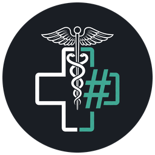
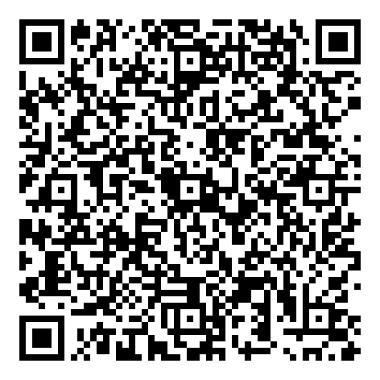

<p align="center"></p>

<h1 align="center">MarkMed</h1>

<div align="center">
  <strong>Editor de prontuários e evoluções médicas offline, portátil e seguro</strong><br>
  Feito para médicos que precisam de velocidade no plantão, independência de sistemas instáveis e backup fácil na nuvem.
</div>

<br>

<div align="center">
  <a href="https://github.com/slanow/MarkMed/releases">
    
  </a>
  <a href="https://github.com/slanow/MarkMed/wiki/Tutorial-de-Markdown">
    
  </a>
  <a href="#apoiar-via-pix">
    
  </a>
  <a href="https://github.com/sponsors/slanow">
    
  </a>
  <a href="https://ko-fi.com/ronymarkmed">
    
  </a>
  <a href="LICENSE">
    
  </a>
</div>

---

## Para quem é o MarkMed?

O **MarkMed** foi pensado especialmente para **médicos** (plantonistas, clínicos, cirurgiões, residentes e especialistas de ambulatório) que lidam diariamente com **prontuários eletrônicos ruins**: sistemas hospitalares e de clínicas que são lentos, travam no meio da consulta, desconectam por queda de rede ou fazem você perder uma evolução inteira antes de conseguir salvar.

Em vez de escrever direto na caixa de texto instável do sistema do hospital, você redige sua evolução com rapidez e tranquilidade no **MarkMed** — direto do seu computador ou de um **pendrive** — e, ao terminar, clica em **Copiar TXT** para colar o texto limpo no prontuário eletrônico sem erros de formatação.

---

## Objetivo e Segurança Jurídica para Médicos

O objetivo principal do MarkMed é oferecer um **ambiente confiável para criação e guarda segura das suas anotações e evoluções clínicas**, funcionando **100% offline**, em um programa leve que pode ficar dentro de um pendrive e ser copiado facilmente para a nuvem.

### Por que isso traz mais segurança jurídica?

- **Independência contra falhas do sistema hospitalar:** se o prontuário do hospital cair, corromper registros ou apagar o que estava sendo digitado, o seu histórico clínico continua salvo localmente.
- **Prova documental e rastreabilidade cronológica:** manter arquivos organizados por data, plantão ou atendimento (com data e hora de modificação preservadas no sistema de arquivos e na nuvem) ajuda a reconstruir condutas, horários, intercorrências e raciocínio clínico em eventuais **auditorias, glosas, sindicâncias no CRM ou questionamentos judiciais**.
- **Formato aberto e duradouro (`.md` / texto puro):** seus prontuários não ficam presos a um banco de dados fechado ou a uma empresa que pode mudar de sistema. Qualquer computador abre seus arquivos mesmo daqui a décadas.
- **Portabilidade total:** você pode levar o programa e seus arquivos no bolso (pendrive) de um hospital ou consultório para outro, sem depender de instalação na máquina do plantão.

> [!IMPORTANT]
> **Sigilo médico e LGPD:** o MarkMed salva arquivos de texto simples (`.md`) para garantir velocidade, compatibilidade e longevidade. Por conterem dados sensíveis de saúde, proteja o acesso físico ao seu pendrive, utilize uma conta Google com **verificação em duas etapas (2FA)** e, sempre que armazenar dados identificáveis de pacientes na nuvem, dê preferência a compactar a pasta em um arquivo `.zip` com senha antes do envio ou utilizar criptografia de disco.

---

## Principais Recursos

- **Botão `Copiar TXT` (sem Markdown e sem linhas em branco extras):** converte a evolução em texto comum limpo com um único clique (na barra superior, menu _Editar_ ou clique direito), sem espaços duplos entre parágrafos para colar perfeitamente em qualquer sistema hospitalar (MV, Tasy, Philips, etc.).
- **Auto-salvar flexível:** escolha entre salvar automaticamente por **intervalo de tempo** (`1s` a `60s`) ou ativar o salvamento automático **sempre que apertar `Enter`**, garantindo que cada parágrafo digitado já fique gravado no disco ou no pendrive.
- **Nome automático pela 1ª linha + data e hora:** basta digitar o nome do paciente na primeira linha do arquivo para sugerir/renomear automaticamente no padrão `<Nome-Paciente>_YYYY-MM-DD_HH-mm.md`.
- **Desmontagem e ejeção segura do pendrive ao fechar (`umount`):** ao encerrar o MarkMed usando um pendrive, o programa explica as vantagens e oferece desmontar/ejetar automaticamente a unidade — prevenindo corrupção de arquivos e lembrando você de retirar o pendrive do computador do hospital (desativável em _Preferências → Geral_).
- **Backup criptografado com senha (`.mmbak`):** crie cópias compactadas e criptografadas (**AES-256-GCM**) dos prontuários e imagens para guardar no Google Drive com tranquilidade pela LGPD, e descriptografe diretamente dentro do próprio MarkMed.
- **Modo Portátil (Pendrive) com pastas ocultas imediatas:** na primeira abertura, o MarkMed configura automaticamente as pastas ocultas `.markmed-user-data` e `.markmed-imagens` no pendrive sem precisar fechar ou reiniciar o aplicativo, e monitora o espaço livre em disco com barra discreta no rodapé.
- **Corretor ortográfico ativo por padrão no idioma do sistema:** já vem ligado automaticamente em português (`pt-BR`) ou no idioma do seu sistema operacional.
- **Barra lateral com botões rápidos (`Abrir Pasta`, `Criar Pasta`, `Criar Arquivo`):** crie novas pastas e prontuários com 1 clique diretamente na barra lateral.
- **Temas Claro e Escuro:** interface limpa para uso confortável tanto em consultórios bem iluminados quanto em plantões noturnos.
- **Escrita sem distrações:** modos Foco e Máquina de Escrever, suporte a listas, tabelas, títulos e exportação rápida para **PDF** e **HTML** — consulte o **[Tutorial Completo de Markdown para Leigos](https://github.com/slanow/MarkMed/wiki/Tutorial-de-Markdown)** na nossa Wiki.

---

## Como Instalar e Usar (PC ou Pendrive)

Baixe a versão mais recente para o seu sistema na página oficial de lançamentos:

👉 **[Baixar o MarkMed (Releases no GitHub)](https://github.com/slanow/MarkMed/releases)**

### Windows

- **Para usar no Pendrive (recomendado no plantão):**
  1. Baixe o arquivo `markmed-win-x64-<versao>-portable.exe` (ou `arm64`, se aplicável).
  2. Copie esse arquivo para dentro de uma pasta no seu pendrive (por exemplo, `MarkMed\`).
  3. Na primeira abertura, autorize o MarkMed a criar automaticamente as pastas ocultas **`.markmed-user-data`** e **`.markmed-imagens`** ao lado do executável (ou veja o passo a passo manual na [Wiki](https://github.com/slanow/MarkMed/wiki/Pastas-e-Configuracao-Inicial)). Assim, configurações, imagens e histórico ficam protegidos dentro do próprio pendrive, sem deixar rastro no computador do hospital.
  4. Crie também uma pasta **`Prontuarios`** no pendrive para salvar suas evoluções em `.md`.
- **Para instalar no seu computador pessoal:**
  - Baixe e execute o instalador `markmed-win-x64-<versao>-setup.exe`.

> [!NOTE]
> **Aviso "O Windows protegeu o computador" (Fornecedor desconhecido / SmartScreen):**
> Como o MarkMed é um projeto gratuito e de código aberto (sem certificado comercial pago da Microsoft), na primeira abertura o Windows pode exibir uma janela azul do **Microsoft Defender SmartScreen**. Isso é normal para aplicativos independentes:
>
> 1. Clique em **Mais informações** (_More info_).
> 2. Clique no botão **Executar assim mesmo** (_Run anyway_).
>    Nas aberturas seguintes naquele computador, o Windows abrirá o MarkMed diretamente sem perguntar novamente.

### Linux

1. Baixe o arquivo `markmed-linux-<versao>.AppImage` (x64 ou arm64).
2. Coloque-o na pasta desejada (ou no pendrive) e dê permissão de execução pelo gerenciador de arquivos (_Propriedades → Permissões → Permitir execução_) ou via terminal:
   ```sh
   chmod +x markmed-linux-*.AppImage
   ```
3. Na primeira abertura, aceite a criação automática das pastas ocultas **`.markmed-user-data`** e **`.markmed-imagens`** ao lado do `.AppImage` para manter todas as configurações portáteis.

### macOS

1. Baixe o arquivo `.dmg` correspondente ao seu Mac (`arm64` para Apple Silicon M1/M2/M3/M4 ou `x64` para Intel).
2. Abra o `.dmg` e arraste o **MarkMed** para a pasta **Aplicativos**.
3. Como as compilações comunitárias ainda não possuem assinatura paga da Apple, caso o macOS bloqueie a abertura na primeira vez, execute no Terminal:
   ```sh
   xattr -d com.apple.quarantine /Applications/MarkMed.app
   ```

---

## Minitutorial: Como Fazer Backup no Google Drive (Copiar e Colar)

Depois do plantão ou ao final do dia, leve apenas alguns segundos para enviar seus prontuários do pendrive para a nuvem:

1. **Organize suas pastas no pendrive:**
   Dentro do pendrive, mantenha uma pasta principal, por exemplo:
   ```text
   📁 Meu_Pendrive/
   ├── 📁 MarkMed/
   │   ├── markmed-win-x64-0.26.0-portable.exe
   │   ├── 📁 .markmed-user-data/
   │   └── 📁 .markmed-imagens/
   └── 📁 Prontuarios/
       └── 📁 2026-11/
           └── 📁 Plantao_01_11/
               └── paciente-iniciais-leito-12.md
   ```
2. _(Opcional recomendado para LGPD)_ Compacte a pasta do dia ou do mês em um arquivo `.zip` com senha (usando 7-Zip, WinRAR ou o compactador do sistema).
3. **Abra o Google Drive no navegador:** acesse [https://drive.google.com](https://drive.google.com) com sua conta Google protegida por verificação em duas etapas.
4. **Copie os arquivos do pendrive para a nuvem** usando o método mais rápido para você:
   - **Método A — Arrastar e soltar (mais fácil):** abra a pasta `Prontuarios` no seu computador em uma janela e deixe o Google Drive aberto em outra. Selecione a pasta do dia/mês (ou o `.zip` com senha), **arraste para dentro da janela do Google Drive** e solte.
   - **Método B — Copiar e Colar (`Ctrl+C` / `Ctrl+V`):** no explorador de arquivos do computador, clique na pasta ou arquivo no pendrive e aperte **`Ctrl + C`** (`Cmd + C` no Mac). Em seguida, clique dentro da pasta de backup no Google Drive no navegador e aperte **`Ctrl + V`** (`Cmd + V` no Mac) — em navegadores modernos (Chrome, Edge, Brave), o upload inicia automaticamente.
   - **Método C — Botão `+ Novo`:** dentro do Google Drive, clique em **`+ Novo` → `Upload de pasta`** (ou **`Upload de arquivo`**) e selecione a pasta `Prontuarios` do seu pendrive.
5. **Confirme o envio:** aguarde o ícone verde de concluído no canto inferior direito do Google Drive antes de remover o pendrive com segurança.

---

## Desenvolvimento e Compilação

Para quem deseja contribuir ou compilar o MarkMed a partir do código-fonte (requer **Node.js >= 22.12.0** e **pnpm >= 10**):

```sh
pnpm install
pnpm run dev
```

Comandos de build e verificação:

```sh
# Verificações de código e testes
pnpm run lint
pnpm run typecheck
pnpm run test

# Gerar pacotes de distribuição (saída em dist/)
pnpm run build:unpack
pnpm run build:linux
pnpm run build:win
pnpm run build:mac
```

---

## Apoiar o Projeto

O **MarkMed** é gratuito e de código aberto. Se ele ajuda no seu dia a dia médico ou no plantão, você pode apoiar o desenvolvimento contínuo pelo **[Pix](#apoiar-via-pix)**, pelo **[Ko-fi](https://ko-fi.com/ronymarkmed)**, pelo **[GitHub Sponsors](https://github.com/sponsors/slanow)** ou pelo botão **Sponsor** no topo do repositório.

### Apoiar via Pix

<p></p>

- **Chave Aleatória:** `9f927cf7-bf61-4a3a-80c7-8cfef0f89e2e`
- **Página dedicada na Wiki:** [Apoiar via Pix](https://github.com/slanow/MarkMed/wiki/Apoiar-via-Pix)

**Pix Copia e Cola:**

```text
00020126950014BR.GOV.BCB.PIX01369f927cf7-bf61-4a3a-80c7-8cfef0f89e2e0233Muito obrigado pela contribuição.5204000053039865802BR5925Ronald Nicolas Ferreira S6009SAO PAULO62140510o8jFdp8r2Y6304D1DB
```

---

## Licença

Distribuído sob a licença **[MIT](LICENSE)** — baseado no projeto [MarkText](https://github.com/marktext/marktext).
